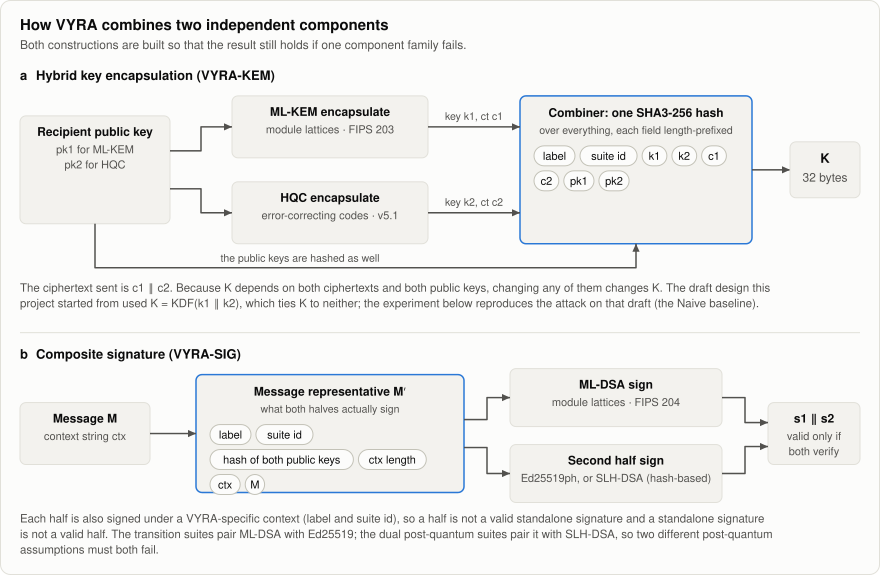
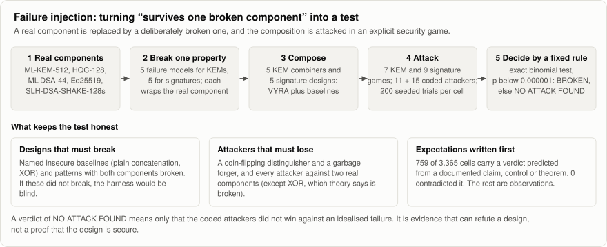
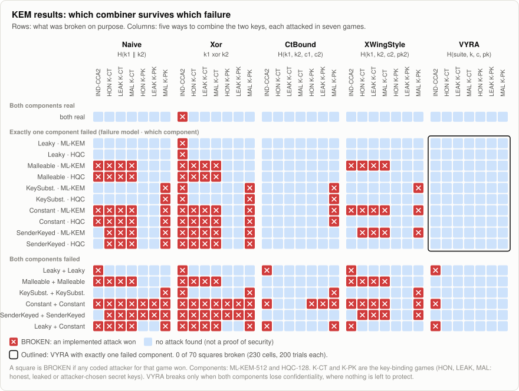
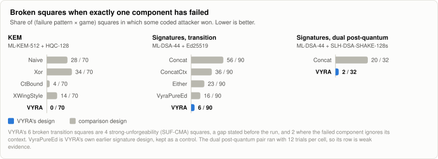
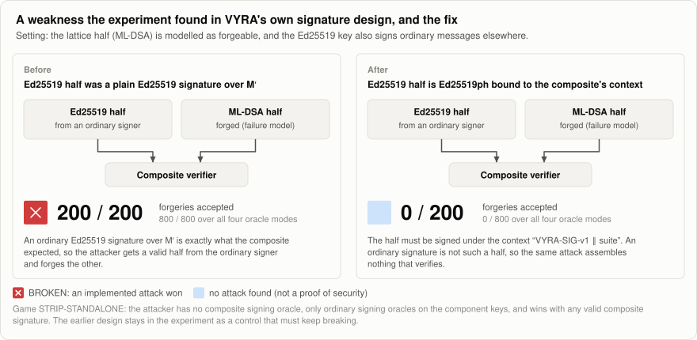
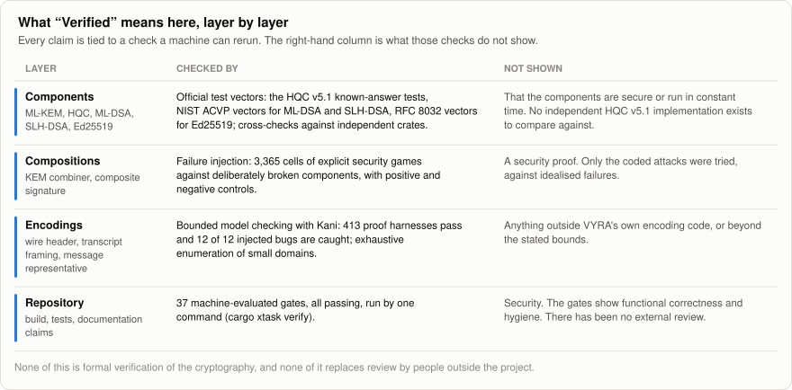
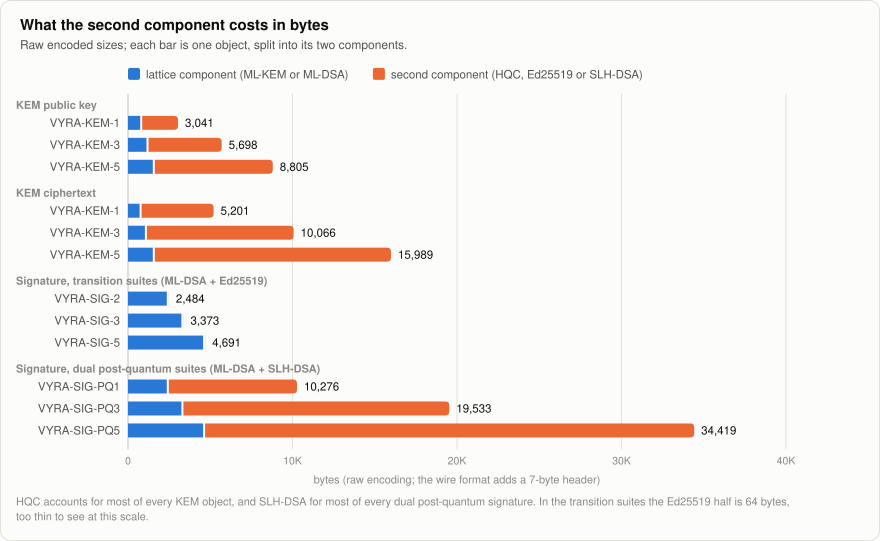
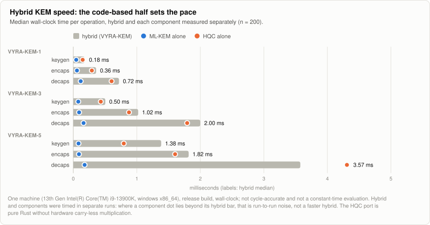
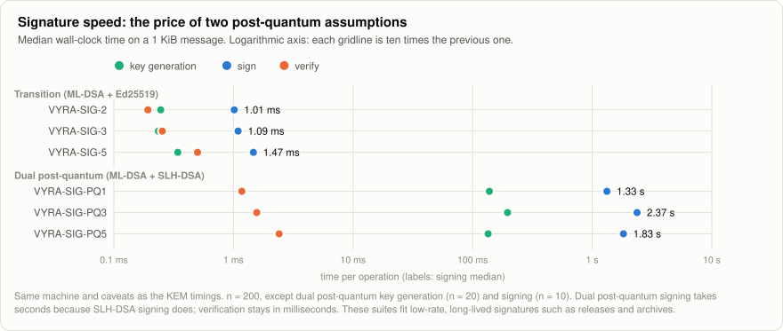

# VYRA

[](https://github.com/marketstandard/VYRA/actions/workflows/ci.yml)
[](#license)
[](docs/BUILDING.md)
[](Cargo.toml)
[](#status)

VYRA is a hybrid post-quantum cryptography library in Rust that combines ML-KEM with HQC for key encapsulation, and ML-DSA with either Ed25519 (transition suites) or SLH-DSA (dual post-quantum suites) for signatures.

**[Quick start](#quick-start)** · **[Results](#results)** · **[Paper](paper/vyra.pdf)** · **[Specification](docs/SPEC.md)** · **[Security limits](#security)** · **[Contributing](#contributing)** · **[Cite](#citing-vyra)**

## Status

> STATUS: RESEARCH PROTOTYPE. NOT FOR PROTECTING REAL DATA.
> VYRA has had no independent cryptanalysis and no external security review.
> Its hybrid constructions, encodings and wire formats are VYRA-original and
> unanalysed. HQC follows the v5.1 specification through an in-tree port; it is
> not yet a published standard. Timing behaviour of the component
> implementations has not been rigorously measured. Use it to study hybrid
> post-quantum designs, not to protect real data.

## The idea

A hybrid scheme uses two components built on different mathematics, so that a break of one family does not break the whole. VYRA's question is whether a given way of gluing the two together actually delivers that, and it answers by experiment: break one component on purpose and attack the result.

<p align="center"><picture>
  <source media="(prefers-color-scheme: dark)" srcset="docs/figures/construction-dark.svg">
  
</picture></p>

## Method: failure injection

<p align="center"><picture>
  <source media="(prefers-color-scheme: dark)" srcset="docs/figures/method-dark.svg">
  
</picture></p>

The experiment lives in `crates/vyra-yield`. It is deterministic: `results/yield-matrix.json` is regenerated byte for byte by gate Y2. The full method, the games and their sources are in [the paper](paper/vyra.pdf) and in [results/yield-matrix.md](results/yield-matrix.md).

## Results

<p align="center"><picture>
  <source media="(prefers-color-scheme: dark)" srcset="docs/figures/kem-matrix-dark.svg">
  
</picture></p>

With exactly one failed component, no coded attacker won against VYRA's combiner in any game. The plain-concatenation combiner of the original draft falls to a mauling attack, XOR falls even with two sound components, and leaving the public keys or one ciphertext out of the hash costs binding. None of the breaks is new to the literature; what is new here is that they are executable, side by side, in one harness with controls.

<p align="center"><picture>
  <source media="(prefers-color-scheme: dark)" srcset="docs/figures/summary-dark.svg">
  
</picture></p>

The experiment also found a weakness in VYRA's own first signature design, which was then fixed and kept in the matrix as a control:

<p align="center"><picture>
  <source media="(prefers-color-scheme: dark)" srcset="docs/figures/sig-fix-dark.svg">
  
</picture></p>

What these results cannot show is listed under [Security](#security) and, in full, in the paper's threats-to-validity section: the failure models are idealised, only coded attacks were tried, most cells are observations and not predictions, and only large advantages are visible at 200 trials.

## What the name means

VYRA stands for *Verified Yielding Resistance Architecture*. Both halves are meant narrowly.

- **"Verified"** means that every claim in this repository is tied to a reproducible machine check: official known-answer vectors for the components, VYRA's own known-answer vectors, failure-injection games (`crates/vyra-yield`), and exhaustive enumeration and bounded model checking of VYRA's own encodings (`crates/vyra-proofs`, `tools/kani`), all run by `cargo xtask verify` ([docs/CHECKS.md](docs/CHECKS.md)). It does **not** mean formal verification of the cryptography, a security proof of VYRA's constructions, or external review. None of those exist.
- **"Yielding Resistance"** means that VYRA is *designed* so that its security goals survive one component family yielding: for key establishment, lattices (ML-KEM) and codes (HQC); for signatures in the dual post-quantum suites, lattices (ML-DSA) and hash functions (SLH-DSA). The evidence is a cited theorem for the KEM combiner technique (Giacon, Heuer and Poettering, PKC 2018), an unreviewed proof sketch for the composite signature, and failure-injection experiments (`results/yield-matrix.md`): with one deliberately broken toy component, none of the implemented attacks won against the stated goals (KEM: IND-CCA2 and the binding games; signatures: EUF-CMA). Strong unforgeability and the separation of the composite halves are not expected to survive a broken component, and the experiments show them lost. That is evidence, not a proof for VYRA's concrete instantiation. The transition signature suites keep only ML-DSA against a quantum attacker.

<p align="center"><picture>
  <source media="(prefers-color-scheme: dark)" srcset="docs/figures/evidence-dark.svg">
  
</picture></p>

## What it provides

VYRA has three parts. Each combines an established post-quantum component with a second, independent component.

- **Hybrid KEM** (`vyra-kem`, re-exported as `vyra::kem`). Suites VYRA-KEM-1, VYRA-KEM-3 and VYRA-KEM-5 pair ML-KEM-512, ML-KEM-768 and ML-KEM-1024 with HQC-128, HQC-192 and HQC-256. The two shared secrets are combined with SHA3-256 over both secrets, both ciphertexts, both public keys and the suite identifier.
- **Composite signature** (`vyra-sig`, re-exported as `vyra::sig`). Both component signatures must verify. Two families:
  - *Transition suites* VYRA-SIG-2, VYRA-SIG-3 and VYRA-SIG-5 pair ML-DSA-44, ML-DSA-65 and ML-DSA-87 with Ed25519, a classical fallback. Small and fast; against a quantum attacker they rest on ML-DSA alone.
  - *Dual post-quantum suites* VYRA-SIG-PQ1, VYRA-SIG-PQ3 and VYRA-SIG-PQ5 pair ML-DSA-44, ML-DSA-65 and ML-DSA-87 with SLH-DSA-SHAKE-128s, -192s and -256s: two post-quantum assumptions (module lattices and hash functions). Signatures are 10-34 KB and signing takes seconds.
- **Custom assembly** (`vyra::kem::CustomHybridKem`, `vyra::sig::CustomComposite`). The same constructions over caller-supplied components, outside the named suites and the wire format; used by the failure-injection experiments.
- **Sealed box** (`vyra-seal`, re-exported as `vyra::seal`). One-shot public-key encryption of a message to a KEM public key, built from the hybrid KEM and ChaCha20-Poly1305. It does not authenticate the sender.
- **Command-line tool** (`vyra-cli`). Key generation, encapsulation, signing, verification, sealing, opening, and an in-memory demo.

Sizes below are from `vyra info`. They are in bytes and include the 7-byte VYRA wire header, except shared secrets, which are raw.

Hybrid KEM suites:

| Suite | Components | Category | Public key | Secret key | Ciphertext | Shared secret |
|-------|------------|---------:|-----------:|-----------:|-----------:|--------------:|
| VYRA-KEM-1 | ML-KEM-512 + HQC-128 | 1 | 3048 | 119 | 5208 | 32 |
| VYRA-KEM-3 | ML-KEM-768 + HQC-192 | 3 | 5705 | 119 | 10073 | 32 |
| VYRA-KEM-5 | ML-KEM-1024 + HQC-256 | 5 | 8812 | 119 | 15996 | 32 |

Composite signature suites (`--suite` is the value `vyra sig keygen --suite` takes):

| Suite | Family | `--suite` | Components | Category | Public key | Secret key | Signature |
|-------|--------|-----------|------------|---------:|-----------:|-----------:|----------:|
| VYRA-SIG-2 | transition | `2` | ML-DSA-44 + Ed25519 | 2 | 1351 | 87 | 2491 |
| VYRA-SIG-3 | transition | `3` | ML-DSA-65 + Ed25519 | 3 | 1991 | 87 | 3380 |
| VYRA-SIG-5 | transition | `5` | ML-DSA-87 + Ed25519 | 5 | 2631 | 87 | 4698 |
| VYRA-SIG-PQ1 | dual post-quantum | `pq1` | ML-DSA-44 + SLH-DSA-SHAKE-128s | 1 | 1351 | 103 | 10283 |
| VYRA-SIG-PQ3 | dual post-quantum | `pq3` | ML-DSA-65 + SLH-DSA-SHAKE-192s | 3 | 2007 | 127 | 19540 |
| VYRA-SIG-PQ5 | dual post-quantum | `pq5` | ML-DSA-87 + SLH-DSA-SHAKE-256s | 5 | 2663 | 151 | 34426 |

Sealed box overhead (sealed size minus plaintext size):

| Suite | Overhead |
|-------|---------:|
| VYRA-KEM-1 | 5224 |
| VYRA-KEM-3 | 10089 |
| VYRA-KEM-5 | 16012 |

For transition suites, the category is that of the ML-DSA component; Ed25519 offers about 128-bit classical security and none against a quantum attacker. For dual post-quantum suites, the category is the minimum of both components' categories (ML-DSA-44 is category 2 and SLH-DSA-SHAKE-128s category 1, so VYRA-SIG-PQ1 is 1). Dual post-quantum signing is slow: each signature takes seconds (1-6 s measured in release builds on the development machine, depending on suite and load), key generation 0.1-0.6 s, and verification milliseconds. They suit low-rate, long-lived signatures such as releases and archives.

<p align="center"><picture>
  <source media="(prefers-color-scheme: dark)" srcset="docs/figures/sizes-dark.svg">
  
</picture></p>

<p align="center"><picture>
  <source media="(prefers-color-scheme: dark)" srcset="docs/figures/perf-kem-dark.svg">
  
</picture></p>

<p align="center"><picture>
  <source media="(prefers-color-scheme: dark)" srcset="docs/figures/perf-sig-dark.svg">
  
</picture></p>

Timings are wall-clock medians on one machine from [results/benchmarks.md](results/benchmarks.md); they are not a constant-time evaluation.

## What is established and what is VYRA's own

| Part | Status | Notes |
|------|--------|-------|
| ML-KEM-512/768/1024 (FIPS 203) | Established | `ml-kem` crate, used unmodified |
| HQC-128/192/256 | Established, pre-standard | HQC v5.1 specification via the in-tree `vyra-hqc` port, checked against the official v5.1 known-answer tests; not yet a published FIPS standard (docs/DECISIONS.md D-14) |
| ML-DSA-44/65/87 (FIPS 204) | Established | `ml-dsa` crate, used unmodified, hedged signing |
| Ed25519 (RFC 8032) | Established | `ed25519-dalek`, strict verification |
| SLH-DSA-SHAKE-128s/192s/256s (FIPS 205) | Established | `fips205` crate, used unmodified, hedged signing; checked against NIST ACVP vectors |
| ChaCha20-Poly1305 (RFC 8439) | Established | `chacha20poly1305` crate, used unmodified |
| SHA3-256 / SHAKE256 (FIPS 202) | Established | Used through the transcript code |
| Hashing ciphertexts into a KEM combiner | Established technique | Giacon, Heuer and Poettering (PKC 2018) |
| KEM-DEM hybrid encryption | Established technique | As in HPKE (RFC 9180) base mode |
| Concrete combiner encoding and suite pairings | VYRA's own | `kem::combine`, `kem::KemSuite` |
| Composite signature message binding and concatenation | VYRA's own | Not the IETF LAMPS composite format |
| Signature suite pairings (both families) | VYRA's own | `sig::SigSuite` |
| Custom assembly entry points | VYRA's own | `kem::CustomHybridKem`, `sig::CustomComposite` |
| Sealed box key derivation, AAD framing and layout | VYRA's own | `seal::SealedBox` |
| Wire format of every serialized object | VYRA's own | `wire` |

The post-quantum components (ML-KEM, HQC, ML-DSA, SLH-DSA) are designed to resist known quantum attacks. VYRA's own parts have no external specification and have been reviewed only within this project. Whether the combinations achieve their intended properties has not been independently analysed.

## Quick start

### Prerequisites

- Rust stable, installed with [rustup](https://rustup.rs). The repository pins `channel = "stable"` in `rust-toolchain.toml`. The crates declare `rust-version = "1.88"` in the root `Cargo.toml`.
- No C compiler is needed.
- `git`, to clone the repository.

### Build, test and verify

```sh
git clone https://github.com/marketstandard/VYRA.git vyra
cd vyra
cargo build --workspace --locked
cargo test --workspace --locked
cargo run -p vyra-cli -- demo
cargo xtask verify
```

`cargo run -p vyra-cli -- demo` prints one line per check and ends with `PASS: all 75 checks passed` when every check succeeds. Every signature suite runs the full set of six signature checks; the three dual post-quantum suites make one SLH-DSA-based signature each, so the demo takes about 10-30 s (debug build; less in release). `cargo xtask` is an alias defined in `.cargo/config.toml`. See [docs/BUILDING.md](docs/BUILDING.md) for platform notes and every command.

## Library usage

The examples below are the front-page examples of the `vyra` crate (`crates/vyra/src/lib.rs`), written out as complete programs. They are the same code that the crate's doctests compile and run.

Add the `vyra` crate to your project. The source is in this repository, so depend on it by path or from `<repository-url>`.

### Hybrid KEM

```rust
use vyra::prelude::*;

fn main() -> vyra::Result<()> {
    let kem = HybridKem::new(KemSuite::Vyra3);
    let mut rng = OsEntropy::new();

    // Recipient: generate a key pair and publish the wire-encoded public key.
    let (pk, sk) = kem.generate(&mut rng)?;
    let pk_wire = pk.to_bytes();

    // Sender: parse the public key (suite read from the header) and encapsulate.
    let pk = HybridPublicKey::from_bytes(&pk_wire)?;
    let (ct, key_sender) = HybridKem::new(pk.suite()).encapsulate_to(&pk, &mut rng)?;
    let ct_wire = ct.to_bytes();

    // Recipient: decapsulate.
    let ct = HybridCiphertext::from_bytes(&ct_wire)?;
    let key_recipient = kem.decapsulate_with(&sk, &ct)?;
    assert!(key_sender.ct_eq(&key_recipient));
    assert_eq!(key_recipient.len(), 32);
    Ok(())
}
```

The KEM alone gives no forward secrecy with a long-term recipient key (docs/DECISIONS.md D-03). Use a fresh key pair per session and drop it afterwards, as `crates/vyra/examples/handshake.rs` does.

### Composite signature

```rust
use vyra::prelude::*;

fn main() -> vyra::Result<()> {
    let scheme = CompositeSignature::new(SigSuite::Vyra3);
    let mut rng = OsEntropy::new();
    let (pk, sk) = scheme.generate(&mut rng)?;

    let sig = scheme.sign(&sk, b"release v0.1.0", b"my-app/releases", &mut rng)?;
    scheme.verify(&pk, b"release v0.1.0", b"my-app/releases", &sig)?;

    // A different message or context is rejected.
    assert!(scheme.verify(&pk, b"release v0.1.1", b"my-app/releases", &sig).is_err());
    assert!(scheme.verify(&pk, b"release v0.1.0", b"other-app", &sig).is_err());
    Ok(())
}
```

### Composite signature, dual post-quantum suite

Same API, another suite. One signature takes seconds.

```rust
use vyra::prelude::*;

fn main() -> vyra::Result<()> {
    let suite = SigSuite::Pq1; // ML-DSA-44 + SLH-DSA-SHAKE-128s
    let scheme = CompositeSignature::new(suite);
    let mut rng = OsEntropy::new();
    let (pk, sk) = scheme.generate(&mut rng)?;
    let sig = scheme.sign(&sk, b"firmware v2.1", b"my-app/firmware", &mut rng)?;
    assert_eq!(sig.to_bytes().len(), suite.encoded_signature_len()); // 10283 bytes

    let pk = CompositePublicKey::from_bytes(&pk.to_bytes())?;
    scheme.verify(&pk, b"firmware v2.1", b"my-app/firmware", &sig)?;
    assert!(scheme.verify(&pk, b"firmware v2.2", b"my-app/firmware", &sig).is_err());
    Ok(())
}
```

More examples in `crates/vyra/examples/`: `kem`, `sign` (transition suites), `sign_pq` (dual post-quantum suites, with timings; run it with `--release`), `seal`, and `handshake` (an illustration, not an analysed protocol; `-- --pq` makes the responder sign with VYRA-SIG-PQ3 instead of VYRA-SIG-3).

### Sealed box

```rust
use vyra::prelude::*;

fn main() -> vyra::Result<()> {
    let suite = KemSuite::Vyra1;
    let mut rng = OsEntropy::new();
    let (pk, sk) = HybridKem::new(suite).generate(&mut rng)?;

    let sbox = SealedBox::new(suite);
    let sealed = sbox.seal(&pk, b"header", b"meet at noon", &mut rng)?;
    let opened = sbox.open(&sk, b"header", &sealed)?;
    assert_eq!(opened.expose(), b"meet at noon");

    // Wrong associated data: rejected.
    assert_eq!(sbox.open(&sk, b"other", &sealed).map(|_| ()), Err(Error::DecryptionFailed));
    Ok(())
}
```

The sealed box does not authenticate the sender and gives no forward secrecy with a long-term recipient key.

## CLI usage

The examples below use the command name `vyra`. From the workspace, run them as `cargo run -p vyra-cli -- <arguments>`, or use the built binary `target/debug/vyra` (`target\debug\vyra.exe` on Windows).

```text
vyra - command-line tool for the VYRA research prototype
       (hybrid ML-KEM + HQC KEM; composite signatures ML-DSA + Ed25519
        and ML-DSA + SLH-DSA; sealed box). Not for protecting real data.

USAGE:
  vyra info
  vyra demo
  vyra kem keygen  --suite <1|3|5> --pk <file> --sk <file>
  vyra kem encaps  --pk <file> --ct <file> --ss <file>
  vyra kem decaps  --sk <file> --ct <file> --ss <file>
  vyra sig keygen  --suite <2|3|5|pq1|pq3|pq5> --pk <file> --sk <file>
  vyra sig sign    --sk <file> --in <file> [--context <str>] --sig <file>
  vyra sig verify  --pk <file> --in <file> --sig <file> [--context <str>]
  vyra seal        --pk <file> --in <file> --out <file> [--aad <str>]
  vyra open        --sk <file> --in <file> --out <file> [--aad <str>]
  vyra help | --help | -h
  vyra --version

COMMANDS:
  info     Print the status statement, suites, component names and sizes.
  demo     Run an in-memory end-to-end demonstration over every suite; prints
           PASS and exits 0 only if every check passes.
  kem      Hybrid KEM: suite 1 = ML-KEM-512 + HQC-128, 3 = ML-KEM-768 +
           HQC-192, 5 = ML-KEM-1024 + HQC-256.
  sig      Composite signature; both component signatures must verify.
           Transition suites (post-quantum + classical fallback):
             2 = ML-DSA-44 + Ed25519, 3 = ML-DSA-65 + Ed25519,
             5 = ML-DSA-87 + Ed25519.
           Dual post-quantum suites (two post-quantum assumptions):
             pq1 = ML-DSA-44 + SLH-DSA-SHAKE-128s, pq3 = ML-DSA-65 +
             SLH-DSA-SHAKE-192s, pq5 = ML-DSA-87 + SLH-DSA-SHAKE-256s;
             signatures of 10-34 KB, and signing takes seconds.
           Suite names are case-insensitive. The context string (default
           empty, at most 255 bytes) must be the same for sign and verify.
  seal     Encrypt a file to a KEM public key (no sender authentication).
  open     Decrypt a sealed file with the matching KEM secret key.

FILES:
  Keys, ciphertexts, signatures and sealed boxes are written in the binary
  VYRA wire encoding (7-byte header: "VYRA", version, object type, suite).
  The suite is read from that header, so only keygen takes --suite.
  Shared-secret files (--ss) hold the raw 32-byte shared secret.
  Existing output files are not overwritten unless --force is given.
  Secret-key, shared-secret and opened-plaintext files are written with the
  default permissions of your system: protecting them (file permissions,
  storage, deletion) is your responsibility. vyra never prints secrets.

EXIT CODES:
  0  success (for `sig verify`: the signature is valid)
  1  rejected: invalid signature, or a sealed box that failed to open
  2  usage error
  3  file missing, unreadable, unwritable, or not a valid VYRA object
  4  unexpected failure, or a `demo` check failed
```

### Worked example: hybrid KEM

```sh
# Recipient generates a key pair (suite 1 = ML-KEM-512 + HQC-128).
vyra kem keygen --suite 1 --pk recipient.pk --sk recipient.sk

# Sender encapsulates: writes the ciphertext and a 32-byte shared secret.
vyra kem encaps --pk recipient.pk --ct handshake.ct --ss sender.ss

# Recipient decapsulates the ciphertext into its own shared secret.
vyra kem decaps --sk recipient.sk --ct handshake.ct --ss recipient.ss

# Both shared-secret files must be identical. Decapsulation of a tampered
# ciphertext does not fail: it yields an unrelated secret (implicit rejection).
cmp sender.ss recipient.ss
```

### Worked example: composite signature

```sh
# Signer generates a key pair (suite 3 = ML-DSA-65 + Ed25519).
vyra sig keygen --suite 3 --pk signer.pk --sk signer.sk

# Sign a file; the context must match at verification time.
vyra sig sign --sk signer.sk --in release.txt --context my-app/releases --sig release.txt.sig

# Exit code 0 means the signature is valid; 1 means it was rejected.
vyra sig verify --pk signer.pk --in release.txt --sig release.txt.sig --context my-app/releases
```

### Worked example: dual post-quantum signature

```sh
# Signer generates a key pair (pq3 = ML-DSA-65 + SLH-DSA-SHAKE-192s).
vyra sig keygen --suite pq3 --pk archive.pk --sk archive.sk

# Signing takes seconds; the signature file is 19540 bytes.
vyra sig sign --sk archive.sk --in backup.tar --context my-app/archive --sig backup.tar.sig

# Verification takes milliseconds. Exit code 1 if the file or signature changed.
vyra sig verify --pk archive.pk --in backup.tar --sig backup.tar.sig --context my-app/archive
```

### Worked example: sealed box

```sh
# Recipient generates a KEM key pair (suite 1).
vyra kem keygen --suite 1 --pk bob.pk --sk bob.sk

# Seal a file to Bob's public key, bound to the associated data "invoice-42".
vyra seal --pk bob.pk --in note.txt --out note.sealed --aad "invoice-42"

# Open it with Bob's secret key. The same --aad must be given, or open exits 1.
vyra open --sk bob.sk --in note.sealed --out note.decrypted.txt --aad "invoice-42"
```

The sealed box does not show who sent the file. Use `--force` to overwrite an existing output file.

## Repository layout

```text
vyra/
  crates/
    vyra-core/   shared traits, errors, secret handling, transcript hashing, wire framing
    vyra-hqc/    HQC v5.1 in pure Rust (port of hqc-kem, checked against the official KATs)
    vyra-kem/    hybrid ML-KEM + HQC key encapsulation (VYRA-KEM-1/3/5)
    vyra-sig/    composite signatures: ML-DSA + Ed25519 (VYRA-SIG-2/3/5) and
                 ML-DSA + SLH-DSA (VYRA-SIG-PQ1/3/5)
    vyra-seal/   sealed box: hybrid KEM + ChaCha20-Poly1305
    vyra/        facade crate: re-exports the library crates above, with examples/
    vyra-cli/    the `vyra` command-line tool
    vyra-yield/  failure-injection experiments: deliberately broken (INSECURE) toy
                 components, security games, executable attacks; not re-exported
    vyra-proofs/ exhaustive-enumeration proofs and Kani harnesses for VYRA's own
                 encodings (wire header, transcript framing, ct_eq, entropy adapter)
  tools/kani/    Docker-based Kani runner (run.ps1 / run.sh), mutants, results notes
  tools/figures/ figure generator: draws docs/figures/ and paper/figures/ from results/
  xtask/         repository task runner (verify, vectors, sizes, bench)
  vectors/       known-answer test vectors written by `cargo xtask vectors`
  results/       generated reports: verification, sizes, benchmarks, yield matrix,
                 Kani report
  docs/          specification, design decisions, checks, threat model, research notes
  paper/         write-up source, compiled to paper/vyra.pdf
```

## Verification

- `cargo xtask verify` runs every gate in [docs/CHECKS.md](docs/CHECKS.md) and writes `results/verification-report.json` and `results/verification-report.md`. A gate passes only when its command exits 0.
- `cargo xtask vectors --check` regenerates `vectors/*.json` from fixed seeds and byte-compares the result with the files in the repository. `cargo xtask vectors` writes the files instead.
- `cargo xtask bench` writes `results/benchmarks.json` and `results/benchmarks.md`, with key generation, encapsulation, decapsulation, signing, verification, sealing and opening timings. Timings depend on the machine.
- `cargo xtask sizes` writes `results/sizes.json` and `results/sizes.md` from the code's size constants, and checks them against generated objects.
- `cargo run -p vyra-yield --release --bin yield-report -- --out results/` reruns the failure-injection experiment and writes `results/yield-matrix.json` and `.md` (deterministic; about 2 minutes). Gates Y1 and Y2 check it, including that a fresh run is byte-identical to the committed matrix.
- `python tools/figures/gen_figures.py` redraws every figure in this README and the paper's diagrams from `results/`; with `--check` it exits 1 if a committed figure no longer matches the results. Statements a figure makes about the data are asserted before drawing.
- `cargo test -p vyra-proofs` runs the exhaustive-enumeration proofs over the stated finite domains (gate V1).
- `powershell -File tools\kani\run.ps1` (Windows) or `tools/kani/run.sh` (Linux, macOS) runs the Kani bounded model checker in Docker and writes `results/kani-report.txt` (minutes to hours; needs a running Docker daemon). Gate V2 judges that report; without one it is NOT_RUN, never PASS. `cargo xtask verify --with-kani` runs the runner first.

Passing these checks shows functional correctness, implementation hygiene, and the specific machine-checked properties listed in docs/CHECKS.md. They do not establish that VYRA is cryptographically secure, and docs/CHECKS.md says so explicitly. In particular, failure-injection results are falsification evidence, not a proof: "NO ATTACK FOUND" means only that the implemented attacks did not win against idealised toy failures. Bounded model checking covers only VYRA's own encodings, within the bounds stated in the harnesses, not the cryptographic components.

## Security

VYRA is a research prototype. Read these limits before anything else. The full discussion is in [docs/SECURITY.md](docs/SECURITY.md) and [docs/THREAT_MODEL.md](docs/THREAT_MODEL.md).

- **HQC is not yet a standard, and VYRA maintains its own port.** `vyra-hqc` implements the HQC v5.1 specification and reproduces all official v5.1 known-answer tests, but FIPS 207 is unpublished and may differ, no independent v5.1 implementation exists to test against, and the port is new cryptographic code reviewed only inside this project (docs/DECISIONS.md D-14).
- **No forward secrecy with static keys.** Anyone holding a long-term secret key can decapsulate every ciphertext recorded for it. Use a fresh key pair per session and discard it afterwards (D-03).
- **No side-channel evaluation.** VYRA adds no masking, fault countermeasures or power or electromagnetic testing (D-05). The timing behaviour of the upstream crates has not been measured.
- **Upstream crates are not audited by this project.** The component crates are used unmodified, and VYRA has had no external security review.
- **No security proof for the concrete constructions.** The combiner encoding, signature message binding, sealed-box layout and wire format are VYRA's own and have no proof.
- **Ed25519 gives no protection against a quantum attacker.** Against one, a transition-suite composite signature rests on ML-DSA alone (D-08). The dual post-quantum suites are intended to hold if either ML-DSA or SLH-DSA does; there is only an unreviewed proof sketch for this, written for the transition suites.
- **Dual post-quantum signatures are large and slow to sign.** Signatures are 10-34 KB, and each one takes seconds to make. They are not meant for high-rate signing.
- **The evidence is not proof.** The yielding-resistance experiments test idealised toy failures against a fixed set of implemented attacks; they cannot show security against attacks that were not implemented. Bounded model checking and exhaustive enumeration cover only VYRA's own encodings within stated bounds, not ML-KEM, HQC, ML-DSA, SLH-DSA or Ed25519.
- **The sealed box has further limits.** It does not authenticate the sender, gives no forward secrecy with a long-term recipient key, reveals the plaintext length, and has no replay protection.

To report a vulnerability, follow [SECURITY.md](SECURITY.md).

## Documentation

- [docs/SPEC.md](docs/SPEC.md): specification of suites, encodings and the wire format.
- [docs/SECURITY.md](docs/SECURITY.md): assumptions, attack models, side channels, limitations and open questions.
- [docs/THREAT_MODEL.md](docs/THREAT_MODEL.md): threat model.
- [docs/DECISIONS.md](docs/DECISIONS.md): design decisions and deviations from the research report.
- [docs/CHECKS.md](docs/CHECKS.md): the verification gates.
- [docs/BUILDING.md](docs/BUILDING.md): reproducible build on Windows, Linux and macOS.
- [docs/ATTEMPTS.md](docs/ATTEMPTS.md): record of earlier attempts.
- [paper/vyra.pdf](paper/vyra.pdf): the write-up (built from `paper/vyra.typ`).
- [vectors/README.md](vectors/README.md): the known-answer vectors.
- [RULES.md](RULES.md): the invariants that security-relevant fixes protect.

## Contributing

Contributions are welcome, and you do not need to be a cryptographer to make one. The most useful thing anyone can do for this project is to break it: add an attack to `crates/vyra-yield` that wins where the matrix says "no attack found", or point out a claim that the evidence does not support.

- [CONTRIBUTING.md](CONTRIBUTING.md): how to set up, what to run before a pull request, and the ground rules.
- [Open an issue](https://github.com/marketstandard/VYRA/issues/new/choose): bug report, attack or research finding, or feature request.
- [CODE_OF_CONDUCT.md](CODE_OF_CONDUCT.md): how we treat each other.
- [SECURITY.md](SECURITY.md): private reporting of implementation flaws.
- [SUPPORT.md](SUPPORT.md): where to ask questions.

## Citing VYRA

If you use VYRA or its results, please cite the repository. GitHub's "Cite this repository" button reads [CITATION.cff](CITATION.cff); in BibTeX:

```bibtex
@software{vyra2026,
  author = {Junior, Carrington and Huffine, Trey},
  title  = {{VYRA}: Testing Yielding Resistance in Hybrid Post-Quantum Constructions by Failure Injection},
  year   = {2026},
  organization = {Market Standard, LLC},
  url    = {https://github.com/marketstandard/VYRA}
}
```

## Authors

VYRA was written by [Encryptic1](https://github.com/Encryptic1) and [Trey Huffine](https://github.com/treyhuffine) at [Market Standard, LLC](https://github.com/marketstandard).

## License

Copyright 2026 Market Standard, LLC.

VYRA is dual-licensed under the MIT License or the Apache License, Version 2.0, at your option. See [LICENSE-MIT](LICENSE-MIT), [LICENSE-APACHE](LICENSE-APACHE) and [NOTICE](NOTICE). `crates/vyra-hqc` is derived from RustCrypto's `hqc-kem` under the same terms; see [crates/vyra-hqc/NOTICE.md](crates/vyra-hqc/NOTICE.md).
